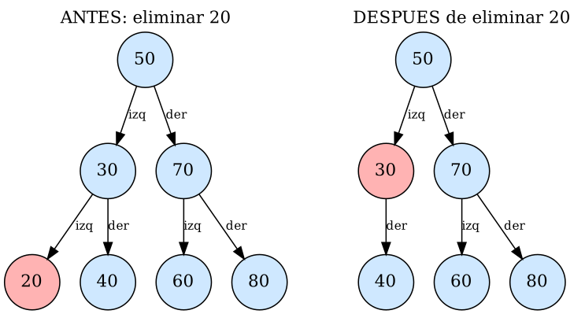
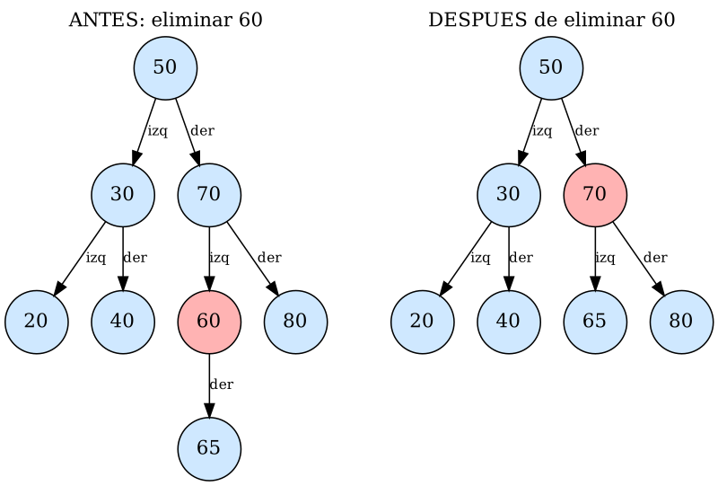
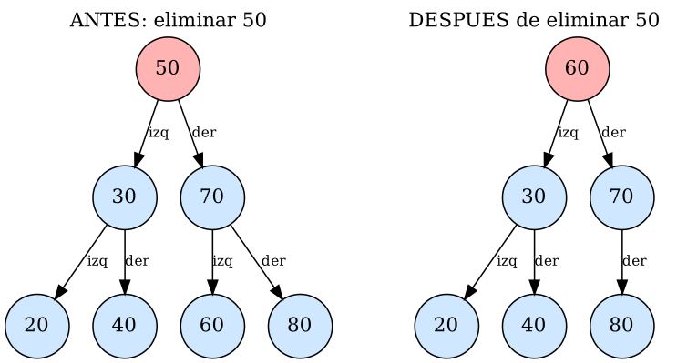

# Guía 5 – BST II: eliminación de nodos

**Asignatura:** Estructura de Datos II · **Semestre:** IV · **Ecosistema:** Java / GitHub

## Objetivo
Eliminar nodos de un BST sin romper su propiedad de ordenación.

## Estructura de la carpeta
```
05-bst-eliminacion/
├── src/            NodoArbol.java, ArbolBST.java, Main.java
├── evidencia/      diagramas antes/después (.png y .dot)
├── Resultados.txt  salida de la ejecución
└── README.md
```

## Compilar y ejecutar
```bash
cd evidencia
javac -encoding UTF-8 -d ../out ../src/NodoArbol.java ../src/ArbolBST.java ../src/Main.java
java -cp ../out Main
```

## Qué se agregó a la Guía 4
- `NodoArbol.setDato()`: necesario para copiar el sucesor en el nodo con dos hijos.
- `minValor(nodo)`: devuelve el mínimo de un subárbol (se baja siempre por la izquierda).
- `eliminar(valor)` / `eliminarRec(nodo, valor)`: eliminación recursiva con los tres casos.
- `esBSTValido()`, `contarNodos()`: para comprobar en las pruebas que el árbol sigue ordenado.

## Los tres casos de eliminación
Árbol base: `50, 30, 70, 20, 40, 60, 80`. El nodo rojo es el que se elimina (antes) o el nodo cuya referencia cambió (después).

### Caso 1: nodo hoja (eliminar 20)


El nodo no tiene hijos. `eliminarRec` devuelve `null`, y el padre (30) guarda ese `null` en su referencia izquierda.

**Referencia que cambia:** `30.izquierdo` pasa de `20` a `null`.

### Caso 2: nodo con un hijo (eliminar 60, con 65 como hijo)
Para probarlo se inserta antes el 65 como hijo derecho de 60.



El nodo se "salta": se devuelve su único hijo y el padre queda apuntando directamente a él.

**Referencia que cambia:** `70.izquierdo` pasa de `60` a `65`.

### Caso 3: nodo con dos hijos (eliminar la raíz 50)


No se puede "saltar" el nodo porque tiene dos hijos. Se hace así:
1. Se busca el **sucesor inorden**: el mínimo del subárbol derecho (aquí, 60).
2. Se **copia** ese valor en el nodo que se quería eliminar (la raíz pasa de 50 a 60).
3. Se **elimina el sucesor original** del subárbol derecho. Como el sucesor no tiene hijo izquierdo, esa eliminación cae en el caso 1 o en el caso 2.

**Referencias que cambian:** el nodo conserva sus referencias izquierda y derecha. Solo cambia su dato y la referencia derecha, que queda apuntando al subárbol sin el sucesor (`70.izquierdo` pasa de `60` a `null`). Como además era la raíz, `eliminar()` hace `raiz = eliminarRec(raiz, valor)`.

## Resumen de referencias que cambian
| Caso | Qué ocurre | Referencia modificada |
|---|---|---|
| Hoja | El padre deja de apuntar al nodo | `padre.hijo = null` |
| Un hijo | El padre apunta al hijo del nodo eliminado | `padre.hijo = hijo del nodo` |
| Dos hijos | Se copia el sucesor y se elimina el original | `nodo.dato = sucesor` y `nodo.derecho` se reasigna |

## Pruebas de ejecución
`Resultados.txt` muestra, para cada caso, el árbol antes y después, el recorrido inorden, si el valor eliminado ya no existe y si el BST sigue siendo válido.

| Prueba | Inorden antes | Inorden después | ¿BST válido? |
|---|---|---|---|
| Eliminar 20 (hoja) | 20 30 40 50 60 70 80 | 30 40 50 60 70 80 | sí |
| Eliminar 60 (un hijo) | 20 30 40 50 60 65 70 80 | 20 30 40 50 65 70 80 | sí |
| Eliminar 50 (dos hijos, raíz) | 20 30 40 50 60 70 80 | 20 30 40 60 70 80 | sí |

Pruebas extra:
- **Sucesor con hijo derecho:** en `50, 30, 70, 60, 65, 80`, al eliminar 50 el sucesor es 60, que tiene a 65 como hijo derecho. El árbol queda con raíz 60 y 65 pasa a ser hijo izquierdo de 70.
- **Valor inexistente:** eliminar 999 no cambia el árbol (7 nodos antes y después).

## Nota: sucesor o antecesor
Se usó el sucesor inorden (mínimo del subárbol derecho). También sería válido usar el antecesor inorden (máximo del subárbol izquierdo); el procedimiento es simétrico.
