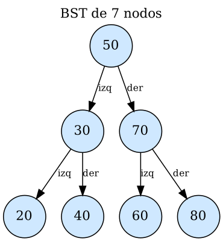
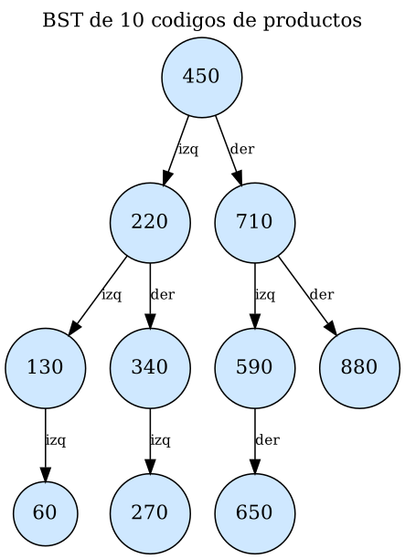

# Guía 6 – Recorridos en árboles binarios

**Asignatura:** Estructura de Datos II · **Semestre:** IV · **Ecosistema:** Java / GitHub

## Objetivo
Implementar y comparar los recorridos Preorden, Inorden, Postorden y por niveles sobre un BST.

## Estructura de la carpeta
```
06-recorridos/
├── src/            NodoArbol.java, ArbolBST.java, Main.java
├── evidencia/      diagramas (.png/.dot) y tabla de secuencias (.csv)
├── Resultados.txt  salida de la ejecución
└── README.md
```

## Compilar y ejecutar
```bash
cd evidencia
javac -encoding UTF-8 -d ../out ../src/NodoArbol.java ../src/ArbolBST.java ../src/Main.java
java -cp ../out Main
```

## Los cuatro recorridos
| Recorrido | Orden de visita | Tipo | Implementación |
|---|---|---|---|
| Preorden | raíz → izquierda → derecha | DFS | recursiva |
| Inorden | izquierda → raíz → derecha | DFS | recursiva |
| Postorden | izquierda → derecha → raíz | DFS | recursiva |
| Por niveles | nivel 0, nivel 1, nivel 2… | BFS | `Queue` (`LinkedList`) |

Cada método devuelve una `List<Integer>` con la secuencia, así se puede imprimir y comparar en las pruebas.

En el recorrido por niveles, la cola funciona como una fila: se saca el primer nodo, se visita, y sus hijos entran al final de la fila. Por eso los nodos salen por profundidad creciente.

## Árbol de 7 nodos (50, 30, 70, 20, 40, 60, 80)


| Recorrido | Secuencia |
|---|---|
| Preorden | 50 30 20 40 70 60 80 |
| Inorden | 20 30 40 50 60 70 80 |
| Postorden | 20 40 30 60 80 70 50 |
| Por niveles | 50 30 70 20 40 60 80 |

## Árbol de 10 productos por código
Orden de inserción: `450, 710, 220, 590, 130, 880, 340, 60, 650, 270`



| Recorrido | Secuencia |
|---|---|
| Preorden | 450 220 130 60 340 270 710 590 650 880 |
| Inorden | 60 130 220 270 340 450 590 650 710 880 |
| Postorden | 60 130 270 340 220 650 590 880 710 450 |
| Por niveles | 450 220 710 130 340 590 880 60 270 650 |

### Inorden frente a una lista ordenada
Los 10 códigos se guardaron en una lista y se ordenaron con `Collections.sort`. El resultado es **idéntico** al Inorden del BST (`¿Son iguales? true`).

Esto pasa porque en un BST todo lo menor está a la izquierda y todo lo mayor a la derecha. Si se visita izquierda, raíz y derecha, los valores salen de menor a mayor. Por eso Inorden sirve como "ordenamiento gratis" de un BST.

## Casos de uso
- **Preorden:** copiar o serializar un árbol, porque la raíz se guarda antes que sus hijos. Si se reinsertan los valores en ese orden, se reconstruye el mismo árbol. También sirve para mostrar una estructura jerárquica, como carpetas.
- **Inorden:** obtener los valores ordenados (listados de productos por código, reportes ordenados) y verificar si un árbol es un BST válido.
- **Postorden:** procesar los hijos antes que el padre. Se usa para eliminar o liberar un árbol completo, y para calcular totales o alturas que dependen de los subárboles.
- **Por niveles:** recorrer por profundidad creciente. Sirve para encontrar el nodo más cercano a la raíz, mostrar el árbol nivel por nivel y resolver problemas de camino mínimo.

## ¿Qué recorrido usar para eliminar un árbol completo de forma segura?
**Postorden.** Se eliminan primero el hijo izquierdo y el hijo derecho, y al final el nodo padre. Así nunca se pierde la referencia a un subárbol antes de procesarlo.

Si se eliminara primero el padre (como en Preorden), se perdería el acceso a sus hijos. En lenguajes sin recolector de basura, esos nodos quedarían huérfanos en memoria.

La clase `ArbolBST` tiene el método `eliminarArbol()` que lo demuestra. Con el árbol de 7 nodos imprime:
```
elimino 20  elimino 40  elimino 30  elimino 60  elimino 80  elimino 70  elimino 50
```
La raíz (50) se elimina de última.

## Pruebas realizadas
- Árbol de 7 nodos: las cuatro secuencias se verificaron a mano.
- Árbol de 10 códigos: las cuatro secuencias se verificaron contra el diagrama, y el Inorden coincide con la lista ordenada.
- Árbol vacío: los cuatro recorridos devuelven una lista vacía sin errores.
- Eliminación completa en Postorden: el árbol queda vacío y la raíz se elimina al final.
