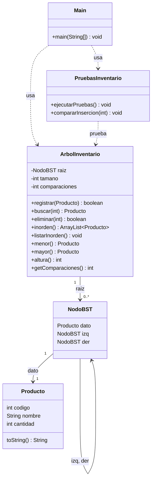

# Guía 7. Reto integrador BST – Sistema de inventario jerárquico

**Asignatura:** Estructura de Datos II · Ingeniería de Software · Semestre IV
**Ecosistema:** Java / GitHub

## Descripción

Aplicación de consola que administra un inventario de productos usando un **árbol binario de búsqueda (BST)**.
La clave del árbol es el `codigo` del producto, así que el inventario siempre se mantiene ordenado por código.
El BST está encapsulado dentro de la clase `ArbolInventario`: el menú nunca toca los nodos directamente.

## Estructura del proyecto

```
07-reto-bst/
├── Producto.java           # Modelo: codigo, nombre, cantidad
├── NodoBST.java            # Nodo del árbol (Producto + hijo izq/der)
├── ArbolInventario.java    # Operaciones del BST (registrar, buscar, eliminar, inorden...)
├── Main.java               # Menú de consola y validación de entradas
├── PruebasInventario.java  # Pruebas automáticas y comparación ordenada vs aleatoria
└── README.md
```

## Cómo compilar y ejecutar

```bash
javac *.java
java Main                # menú interactivo
java PruebasInventario   # pruebas automáticas
```

## Menú

| Opción | Acción |
|---|---|
| 1 | Registrar producto (valida código duplicado) |
| 2 | Buscar producto (muestra el número de comparaciones) |
| 3 | Eliminar producto (valida código inexistente) |
| 4 | Listar inventario en Inorden (queda ordenado por código) |
| 5 | Ver producto de menor y mayor código |
| 6 | Comparar inserción ordenada vs aleatoria |
| 7 | Ejecutar pruebas automáticas |
| 0 | Salir |

## Diagrama de clases



**Responsabilidades**

- `Producto`: guarda los datos de un producto.
- `NodoBST`: une un producto con sus dos hijos.
- `ArbolInventario`: mantiene el invariante de orden (izquierda < nodo < derecha) y no permite códigos repetidos.
- `Main`: interactúa con el usuario y valida lo que escribe (números, textos vacíos, valores negativos).
- `PruebasInventario`: verifica que todo funcione y compara los dos tipos de inserción.

## Complejidad esperada de cada operación

`n` = cantidad de productos, `h` = altura del árbol.
Todas las operaciones de un solo elemento recorren un camino desde la raíz, por eso dependen de `h`.

| Operación | Mejor caso | Caso promedio (inserción aleatoria) | Peor caso (inserción ordenada) |
|---|---|---|---|
| Registrar | O(1) | O(log n) | O(n) |
| Buscar | O(1) | O(log n) | O(n) |
| Eliminar | O(1) | O(log n) | O(n) |
| Listar Inorden | O(n) | O(n) | O(n) |
| Menor / Mayor | O(1) | O(log n) | O(n) |
| Altura | O(n) | O(n) | O(n) |

**Contexto:**

- Si los códigos llegan en orden aleatorio, el árbol queda balanceado más o menos y `h ≈ log n`.
- Si los códigos llegan ya ordenados (1, 2, 3, ...), cada nodo nuevo se cuelga a la derecha y el árbol se vuelve una lista: `h = n`. Ahí todo se vuelve O(n).
- Listar Inorden siempre visita los `n` nodos una vez, sin importar la forma del árbol.
- Eliminar es O(h): bajar hasta el nodo es O(h), y en el caso de dos hijos buscar el sucesor suma otro recorrido de máximo O(h).
- La altura se calcula visitando todos los nodos, por eso es O(n).
- Memoria: O(n) para guardar los nodos; la recursión de eliminar, inorden y altura usa O(h) de pila.

## Resultados de las pruebas

### Pruebas automáticas (`java PruebasInventario`)

Se verifican: árbol vacío, registro, código duplicado (se rechaza y no se sobrescribe), búsqueda de existente e inexistente,
conteo de comparaciones, menor y mayor, orden del Inorden, y los tres casos de eliminación (hoja, un hijo, dos hijos).

```
[OK]    Duplicado 50 es rechazado
[OK]    Buscar 999 (inexistente) devuelve null
[OK]    Buscar 40 usa 3 comparaciones (50, 30, 40)
[OK]    Eliminar nodo con dos hijos (50, la raiz)
[OK]    Eliminar inexistente (999) devuelve false
[OK]    Inorden sigue ordenado tras eliminar
...
Todas las pruebas pasaron.
```

### Inserción ordenada vs aleatoria (n = 1000)

| | Ordenada | Aleatoria |
|---|---|---|
| Altura del árbol | 1000 | 27 |
| Comparaciones al buscar el código 1000 | 1000 | 8 |

Con datos ordenados el BST se degenera en una lista enlazada. Con datos aleatorios la altura se queda cerca de `log₂(1000) ≈ 10`
(en esta prueba salió 27, que sigue siendo muy pequeño frente a 1000). Esto confirma la tabla de complejidades: O(n) en el peor caso y O(log n) en el caso promedio.

### Validaciones del menú

| Situación | Respuesta del sistema |
|---|---|
| Registrar un código que ya existe | "Error: ya existe un producto con el codigo X." |
| Buscar o eliminar un código inexistente | "No existe un producto con el codigo X." |
| Escribir letras donde va un número | "Entrada invalida: escribe un numero entero." y vuelve a pedirlo |
| Código ≤ 0 o cantidad negativa | Se rechaza con mensaje |
| Nombre vacío | "El texto no puede estar vacio." y vuelve a pedirlo |
| Listar, menor o mayor con inventario vacío | "El inventario esta vacio." |
| Opción de menú que no existe | "Opcion no valida." |

## Evidencia

- Código completo en este repositorio.
- Capturas / video del menú funcionando: _(agregar aquí el enlace o las imágenes)_
- Historial de commits: ver pestaña *Commits* del repositorio.
