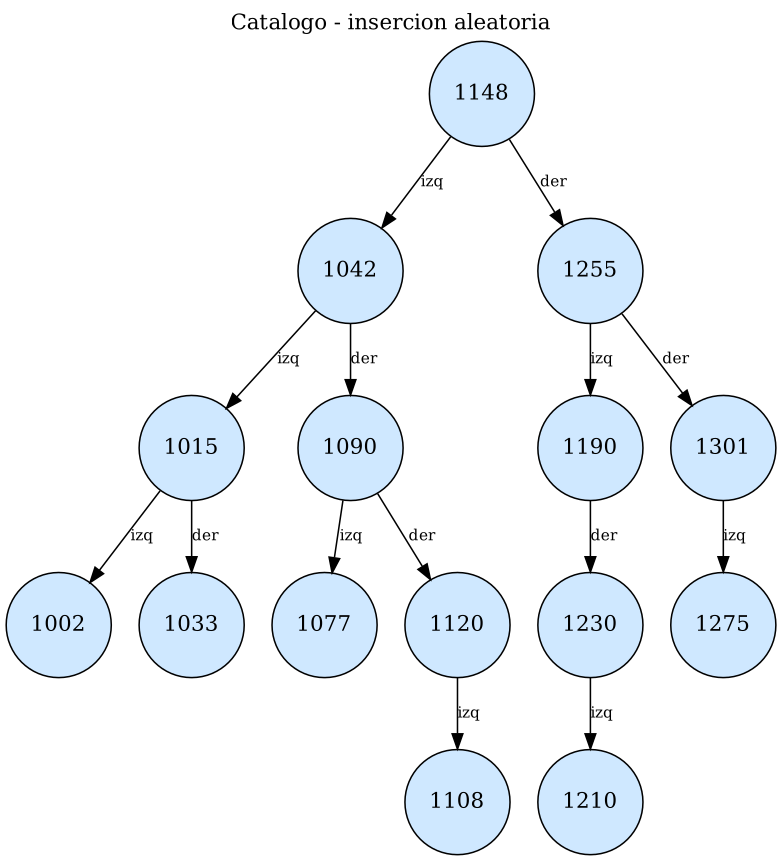
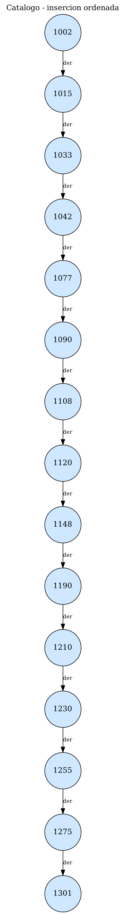

# Reto: "Catálogo inteligente" – BST de productos

**Asignatura:** Estructura de Datos II · **Semestre:** IV · **Ecosistema:** Java / GitHub

## Reto
Construir un BST para almacenar códigos de productos. Implementar inserción y búsqueda recursiva, probar con datos ordenados y aleatorios, y comparar la altura obtenida.

## Estructura de la carpeta
```
reto-catalogo-inteligente/
├── src/            NodoArbol.java, Producto.java, ResultadoBusqueda.java, ArbolBST.java, Main.java
├── evidencia/      diagramas (.png/.dot) y tabla comparativa (.csv)
├── Resultados.txt  salida de la ejecución
└── README.md
```

## Compilar y ejecutar
```bash
cd evidencia
javac -encoding UTF-8 -d ../out ../src/NodoArbol.java ../src/Producto.java ../src/ResultadoBusqueda.java ../src/ArbolBST.java ../src/Main.java
java -cp ../out Main
```

## Cómo funciona
- Cada **producto** tiene código, nombre y precio. El **código** es la clave del BST.
- **Regla BST:** código menor → izquierda, código mayor → derecha. En un catálogo el código es único, así que `insertar()` rechaza los repetidos y devuelve `false`.
- **`insertar()` (recursivo):** si llega a un hueco (`null`), crea el nodo; si no, baja por un solo lado.
- **`buscar()` (recursivo):** devuelve el producto, o `null` si el código no existe.
- **`buscarConTraza()`:** igual que buscar, pero registra el camino y el número de comparaciones.
- **`altura()`:** número máximo de aristas desde la raíz hasta una hoja (árbol vacío = −1, hoja = 0).

## Datos de prueba
Se usan **los mismos 15 productos** en dos órdenes de inserción distintos.

- Aleatorio: `1148, 1042, 1255, 1090, 1190, 1015, 1301, 1120, 1033, 1230, 1077, 1210, 1002, 1275, 1108`
- Ordenado: `1002, 1015, 1033, 1042, 1077, 1090, 1108, 1120, 1148, 1190, 1210, 1230, 1255, 1275, 1301`

Búsquedas: 1002, 1120, 1230, 1301 (existen) y 1200 (no existe).

## Diagramas
**Inserción aleatoria** (altura 4)



**Inserción ordenada** (altura 14: el árbol queda como una lista)



## Tabla comparativa BST ordenado / aleatorio
| Escenario | Productos | Altura (aristas) | Comparaciones (5 búsquedas) | Promedio |
|---|---|---|---|---|
| Aleatorio | 15 | 4 | 20 | 4,00 |
| Ordenado | 15 | 14 | 47 | 9,40 |

Detalle de las búsquedas (comparaciones):

| Código | Aleatorio | Ordenado |
|---|---|---|
| 1002 | 4 | 1 |
| 1120 | 4 | 8 |
| 1230 | 4 | 12 |
| 1301 | 3 | 15 |
| 1200 (no existe) | 5 | 11 |

El código 1002 es el único que sale mejor en el árbol ordenado, porque es el primero que se insertó y queda en la raíz.

## Análisis
- Con inserción **aleatoria**, el árbol quedó balanceado: altura 4, que está cerca de log₂(15) ≈ 3,9. Las búsquedas cuestan unas 4 comparaciones en promedio, es decir **O(log n)**.
- Con inserción **ordenada**, cada código nuevo es mayor que todos los anteriores y siempre se va a la derecha. El árbol se convierte en una cadena de altura n − 1 = 14, y buscar el último código requiere recorrer los 15 nodos: **O(n)**.
- La propiedad BST se cumple en ambos casos, pero el **orden de inserción** cambia la forma del árbol y, con ella, el rendimiento.
- En un catálogo real conviene no cargar los productos ordenados por código, o usar un árbol balanceado (como AVL o rojinegro).

## Pruebas realizadas
- Inserción de 15 productos en orden aleatorio y en orden ascendente.
- Cinco búsquedas en cada árbol, con camino y comparaciones (cuatro existentes y una inexistente).
- Código repetido: `insertar()` devuelve `false` y no modifica el árbol.
- Recorrido inorden: el catálogo se muestra ordenado por código.
